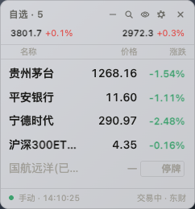

# 摸鱼行情小窗 · moyu-stock

> macOS 透明悬浮行情小窗，为「上班摸鱼」而生 —— 看盘不切屏、异动自己找你、老板来了也不慌。



个人自用工具。数据来自东方财富 / 腾讯公开网页接口（非官方），仅供个人参考，不提供任何交易功能。

## 这是什么

一个常驻 macOS 桌面的透明行情悬浮窗：

- **无框、置顶、半透明**，宽度高度自动贴合内容，可以压在任何窗口上；
- **全屏应用之上也可见**——演示、写文档、开会共享桌面时它都在（还能开启防录屏让它"隐形"）；
- 自选支持手动搜索添加，或**扫码登录东方财富后自动同步账号内全部自选分组**（只读同步，手机上改自选自动跟上）；
- 本地持仓分组：粘贴持仓与成本，实时盯盈亏，与交易账户无关。

## 为什么不用网页 / 行情软件

| 方式 | 问题 |
|---|---|
| 浏览器开行情页 | ⌘Tab / 调度中心直接暴露；切来切去动作大 |
| 全屏行情软件 | 红绿满屏，老板一眼扫到就社死 |
| 手机看盘 | 低头太频繁，本身就是信号 |

行情小窗的答案：**它就在你正在打字的那块屏幕上，小到像一行状态栏，静到没有一点声音**；异动不用你盯，它主动找你。

## 核心特性

- **老板键 ⌥⇧H**：一键隐身（设置窗/登录窗一并藏），再按唤回；可配置连菜单栏文字一起清空，隐身中崩溃/重启都保持隐身
- **会议模式 ⌥⇧M**：开会共享屏幕前按一下 = 隐身 + 防录屏 + 提醒静默 + 菜单栏清空；散会再按，原样恢复并展示错过的提醒
- **防录屏保护**：macOS 内容保护，开启后窗口不出现在截屏/录屏/屏幕共享里
- **鼠标穿透 ⌥⇧X**：窗口变"玻璃"，点击全部落到下层应用；四条恢复通道，穿透期间窗口内有黄条提示
- **菜单栏指数 + 异动信号**：常驻「沪3797 -0.4%」，自选异动时旁边标 ▲/▼——最低调的提醒方式，瞄一眼就走
- **异动提醒三档**：系统横幅 / 菜单栏信号 / 静默；「低调通知」模式下标题正文不出现股票名与价格；隐身/会议期间自动静默累积，唤回后一次性展示
- **单色模式 / 隐藏代码 / 静默脉冲**：红绿颜色是最显眼的暴露特征，全部可关
- **迷你条**：缩成一行标题栏，只留「沪 3809 +0.4% · 涨38 跌12」
- **分时图**：单击行情行原地展开，含当日均价线
- **键盘流**：↑/↓ 选行、Enter 展开分时、⌘F 搜索添加、⌥⇧←/→ 切分组，全程不碰鼠标
- **收盘战报**：交易日 15:05 一条通知，汇总自选平均涨跌、涨跌家数、领涨领跌
- **贴边吸附 / 位置记忆 / 双自适应尺寸**：拖到屏幕边缘自动磁吸，拔掉外接屏窗口也不跑丢

## 30 秒上手

```bash
git clone https://github.com/island-369/moyu-stock.git
cd moyu-stock/stock-widget
npm install
npm start          # 首次启动有三步引导（选来源 → 加自选 → 隐蔽性配置），随时可跳过
```

需要 macOS + Node.js 18+（开发基于 Electron 44）。

## 快捷键速查

| 快捷键 | 作用 |
|---|---|
| ⌥⇧H | 老板键：一键隐身 / 唤回 |
| ⌥⇧S | 显示 / 隐藏小窗 |
| ⌥⇧X | 鼠标穿透开关 |
| ⌥⇧M | 会议模式（隐身 + 防录屏 + 静默） |
| ⌥⇧← / → | 上一个 / 下一个分组 |
| ⌥⇧↑ / ↓ | 背景浓度 ±5% |
| ⌘M / ⌘W | 退到后台（行情继续刷） |
| ⌘F | 聚焦搜索添加 |
| ⌘, | 打开设置 |

全部快捷键可在设置中重新录制，与其他应用冲突时会弹提示。

## 隐蔽性设计（这个项目的灵魂）

摸鱼工具自己不能先暴露。几条贯穿始终的原则：

1. **应用名保持中性**：仓库叫 moyu-stock 没关系，但应用就叫「行情小窗」——Dock、⌘Tab、活动监视器里看到它都只是个普通小工具（LSUIElement 模式下连 Dock 都不驻）；
2. **颜色是第一暴露源**：默认隐藏股票代码、单色模式去红绿、变动脉冲默认关闭；
3. **系统通知本身就是暴露源**：通知中心有历史记录，同事翻一翻全露馅——所以有低调通知（不出现股票名）与菜单栏信号档，隐身时一律静默累积；
4. **所有隐蔽手段都有兜底恢复通道**：穿透了有四条路恢复，隐身了快捷键/托盘都能唤回，改乱了可一键恢复默认快捷键；
5. **渲染层零网络请求**：网络与凭据全部收在主进程，日志强制脱敏，登录 Cookie 只存系统加密存储。

## 架构与可靠性

```
src/
├─ main/            # Electron 主进程：窗口/托盘/快捷键/轮询状态机/IPC
├─ core/            # 零 Electron 依赖（可单测）：行情/搜索/分时/云同步/交易时段
├─ store/           # 原子写 JSON 存储 + 双备份回滚
├─ renderer/        # 无框架渲染层（主窗 + 设置窗，全走 IPC）
└─ shared/          # 端点与常量
```

- **备源切换**：东财主源同一轮内先快重试，连续失败才切腾讯；备源停满 60s 后才探活，连续 2 次成功才切回，没通过则退避翻倍（上限 10 分钟），不再来回横跳
- **时段感知**：竞价/连续竞价/午休/收盘/非交易日各用不同刷新频率，连续无变化自动降速
- **失败三分类**：网络错误退避重试 / 登录过期黄条引导 / 接口变更通知兜底，不会一律黄点
- **快照恢复**：最后一份行情与自选本地留存，断网/崩溃重启先恢复界面再拉新
- **崩溃自愈**：渲染进程崩溃自动重建窗口，隐身态不丢

核心层 51 项单元测试；`npm run smoke` 冒烟自检（真实拉数据 + 自动截图，独立 profile 不污染日常配置）。

更完整的操作手册、接口实测记录与可靠性设计见 [stock-widget/README.md](stock-widget/README.md)；完整方案评审见《行情小窗-方案评审与实现细化.html》。

## 免责声明

- 本项目仅供个人学习与自用，**不构成任何投资建议**；
- 数据来自东方财富 / 腾讯公开网页接口，非官方授权，实时性可能略慢，随时可能变更；
- 请遵守所在公司的办公设备与网络使用规定，摸鱼有风险，看盘需低调。
